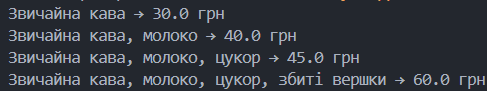

**Львівський національний університет ветеринарної медицини та біотехнологій імені С.З. Ґжицького**

**Кафедра інформаційних технологій**

# Звіт про виконання лабораторної роботи №13
На тему 
"Структурні шаблони проєктування"

Виконала студентка групи Кн-31 Вечера Надія

Прийняв доц. Андрій Татомир

### Львів 2026

---

**Мета роботи** - познайомитися з групою структурних шаблонів
проєктування.

## Хід роботи

Структурні шаблони відповідають за організацію класів і об'єктів у більші структури, спрощуючи їхню композицію та взаємодію. Вони допомагають зробити систему гнучкою, зменшити зв'язаність і забезпечити зручне розширення без зміни існуючого коду.

***Основні поведінкові шаблони:*** 

Адаптер (Adapter) – дозволяє об'єктам з несумісними інтерфейсами працювати разом, перетворюючи інтерфейс одного класу на інтерфейс, очікуваний клієнтом.

Міст (Bridge) – розділяє абстракцію та її реалізацію, дозволяючи їм змінюватися незалежно одна від одної.

Композит (Composite) – об'єднує об'єкти в деревоподібні структури для представлення ієрархій «частина-ціле», дозволяючи клієнтам однаково працювати як з окремими об'єктами, так і з їхніми композиціями.

Декоратор (Decorator) – динамічно додає об'єкту нові обов'язки, обгортаючи його в об'єкт-декоратор без зміни його класу.

Фасад (Facade) – надає спрощений інтерфейс до складної підсистеми, приховуючи її внутрішню складність.

Пристосуванець (Flyweight) – ефективно підтримує велику кількість дрібнозернистих об'єктів, розділяючи спільний стан між ними.

Замісник (Proxy) – надає сурогат або представника іншого об'єкта для контролю доступу до нього, додавання додаткової логіки або відкладення створення.

**Завдання**:

Ось практичний приклад на Python, де програма розраховує підсумкову вартість замовлення з урахуванням різних типів знижок.

Код [програми](lab13.py) де реалізований код.

Результат виконання програми

**Висновок**:
У ході виконання лабораторної роботи я дізналась про поведінкові шаблони та яка кількість їх існує та практично опрацювала один із цих шаблонів проєктування.
