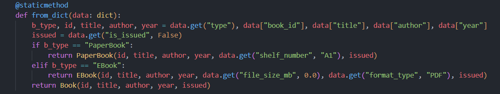
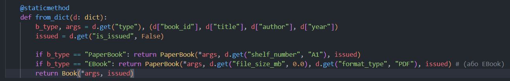

**Львівський національний університет ветеринарної медицини та біотехнологій імені С.З. Ґжицького**

**Кафедра інформаційних технологій**

# Звіт про виконання лабораторної роботи №15
На тему 
"Якість коду. Рефакторинг"

Виконала студентка групи Кн-31 Вечера Надія

Прийняв доц. Андрій Татомир

### Львів 2026

---

**Мета роботи** - дослідити поняття якості програмного забезпечення та його ключові складові

## Теоретичні відомості
1. Якість коду та його характеристики

**Поняття якості коду:** міра того, наскільки добре написана програма відповідає технічним вимогам, стандартам розробки та очікуванням користувачів і розробників.   

**Складові якості коду:** 

**Читабельність (Readability):** здатність коду бути легко зрозумілим для інших програмістів (або автора через деякий час).

**Розширюваність (Extensibility):** легкість внесення майбутніх змін та додавання нового функціоналу без руйнування старої логіки.

**Підтримуваність (Maintainability):** зручність усунення помилок, оновлення залежностей та адаптації продукту.

**Тестуваність (Testability):** можливість простого написання модульних (unit) та інтеграційних тестів для перевірки працездатності.

**“Чистий” та “брудний” код:**   
Чистий код — структурований, зрозумілий, елегантний і легко підтримуваний.
Брудний код — заплутаний, надмірно складний, написаний поспіхом («спагеті-код»), який важко модифікувати.

“Code smells” (запахи коду): певні ознаки в структурі коду, які сигналізують про потенційні глибокі проблеми або порушення архітектурних принципів (наприклад, занадто довгі функції, дублювання коду, великі класи).   

Досвід розробників (Developer Experience, DX): сукупність вражень, зручності та емоційного комфорту програмістів під час роботи з кодовою базою, інструментами, документацією та процесами в команді.   

2. Процес рефакторингу та техніки

Процес рефакторингу: керований процес поліпшення внутрішньої структури вже існуючого коду без зміни його зовнішньої поведінки (бізнес-логіки чи результату виконання).   

**Тестування в процесі рефакторингу:** використання автоматизованих тестів до та після внесення змін, щоб гарантувати, що рефакторинг не зламав наявний функціонал програми.   

**Використання систем контролю версій:** застосування інструментів (наприклад, Git) для збереження історії змін, роботи в ізольованих гілках та безпечного відкату до попередньої стабільної версії коду за потреби.   

**Техніки рефакторингу: стандартні прийоми оптимізації та вдосконалення коду:**   

Перейменування (Renaming): покращення назв змінних, методів чи класів, щоб вони чітко відображали своє призначення.

Переміщення (Moving): перенесення методів або полів у ті класи/модулі, до яких вони логічно належать.

Спрощення або переписування (Simplifying / Rewriting): розбиття складних функцій на менші, зменшення розгалужених умовних операторів та усунення дублювання логіки (принцип DRY).

## Хід роботи

Для завдання я використала шматок коду з курсової роботи де я побачила, що рефакторинг був би доцільним задля усунення більш чистого коду.

Шматок коду до рефакторингу:

Після рефкторингу:

**Що змінилось і чому?**

**Групування спільних аргументів у кортеж (args):**

До: кожен тип книги вимагав ручного перерахування змінних (id, title, author, year), що захаращувало рядок виклику конструктора.

Після: базові поля (book_id, title, author, year), які є спільними для всіх книг, збираються в один кортеж args, а потім передаються в конструктори за допомогою оператора розпакування *args. Завдяки оператору зірочки (*args)  автоматично «розпаковуються» всі чотири базові аргументи на початку виклику конструктора.

**Позбавлення від зайвих конструкцій (elif):**

Конструкція elif замінена на прямі умови if з раннім поверненням (return), що виглядає чистіше та читається швидше.

**Зменшення кількості дублювання (DRY — Don't Repeat Yourself):**

Код став компактнішим і гнучкішим: якщо в майбутньому до базового класу Book додасться ще одне спільне поле (наприклад, language), його достатньо буде додати лише в один рядок кортежу args, замість того, щоб правити кожен return окремо.

Висновки: у ході виконання роботи було досліджено ключові поняття якості програмного забезпечення. На прикладі розробленої системи управління бібліотекою було проаналізовано різницю між «чистим» і «брудним» кодом, а також виявлено потенційні «запахи коду», що ускладнюють подальшу підтримку проєкту. Зокрема, було вдосконалено архітекту об'єктів (метод Book.from_dict), де завдяки групуванню спільних аргументів у кортеж args та використанню оператора розпакування *args вдалося усунути дублювання коду (принцип DRY) і значно підвищити читабельність класу.