**Львівський національний університет ветеринарної медицини та біотехнологій імені С.З. Ґжицького**

**Кафедра інформаційних технологій**

# Звіт про виконання лабораторної роботи №16
На тему 
"Принципи проєктування програмного забезпечення"

Виконала студентка групи Кн-31 Вечера Надія

Прийняв доц. Андрій Татомир

### Львів 2026

---

**Мета роботи** - дослідити практичне застосування принципів проєктування програмного забезпечення (DRY, AHA, KISS та SOLID) та опанувати навички їх реалізації.

## Теоретичні відомості та практичне представлення

**Практичні та теоретичні принципи проєктування. DRY, AHA, KISS** 

**DRY (Don't Repeat Yourself — «Не повторюйся»)** - це базовий принцип проєктування програмного забезпечення, який полягає в тому, що кожне знання чи шматок логіки в системі повинен мати єдину, однозначну й авторитетну реалізацію.   

**Головна мета DRY** — позбутися дублювання коду. Якщо подібна логіка повторюється в багатьох місцях, будь-яка зміна бізнес-правил вимагатиме редагування всіх цих місць, що дуже підвищує ризик припуститися помилки чи щось пропустити.

Приклад коду та його пояснення:

**Погано (без дотримання DRY):** у цьому прикладі логіка обчислення ціни зі знижкою для різних типів клієнтів написана двічі, хоча відрізняється лише відсотком знижки (коефіцієнтом).

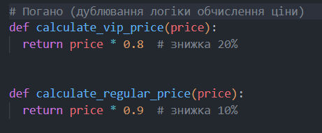

Якщо правила розрахунку ціни зміняться (наприклад, з'явиться додатковий податок або нова умова округлення), вам доведеться змінювати формулу в кожній окремій функції.

**Добре (з дотриманням DRY):** виносимо спільну логіку в одну універсальну функцію calculate_price, яка приймає базову ціну та розмір знижки як параметри.

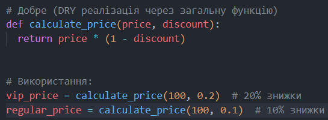

Уся математична логіка зосереджена в одному місці (calculate_price). Якщо формула розрахунку зміниться, достатде оновити код лише всередині однієї цієї функції, а не переписувати весь проєкт.

**AHA (Avoid Hasty Abstractions — «Уникай поспішних абстракцій»):**
принцип доповнює DRY і застерігає від створення занадто складних абстракцій занадто рано. Краще мати невелике дублювання коду на початку, ніж створити неправильну абстракцію, яку потім важко змінити. «Дублювання краще за неправильну абстракцію».

Приклад коду та його пояснення

**Поспішна абстракція (Погано):**
Валідація імені користувача та валідація назви товару трохи схожі (обидві перевіряють мінімальну довжину), і одразу створили «універсальну» функцію з додатковим прапорцем (is_product).

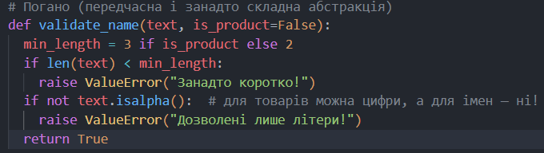

Намагаючись об'єднати два різні випадки в один за допомогою умов (if is_product), створилась жорстка й заплутана абстракція. 

**Добре (Дотримання AHA):**
краще дозволити коду побути злегка дубльованим на початку, доки ви не зрозумієте, як саме він еволюціонуватиме. Поспішати з об'єднанням не варто.

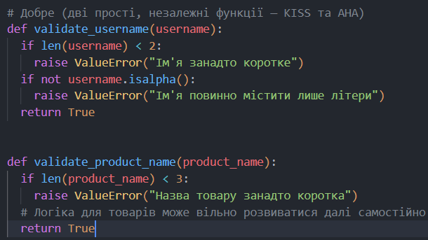

Кожна функція проста, зрозуміла та відповідає за свою специфічну задачу. Якщо вимоги до назв товарів зміняться, вам не доведеться ламати логіку перевірки користувачів. Абстракція створюється лише тоді, коли подібність стає очевидною і стабільною в часі.

**KISS (Keep It Simple, Stupid — «Зроби це простішим, не ускладнюй»)** - він полягає в тому, що система працює найкраще тоді, коли вона проста, а не ускладнена зайвими елементами.

Головне правило KISS: обирай найпростіше рішення, яке вирішує поставлену задачу. Слід уникати надмірного інжинірингу (overengineering) — тобто не потрібно додавати складні алгоритми, паттерни або універсальну логіку «на майбутнє», якщо в цьому немає реальної потреби зараз.

Приклад коду та його пояснення

**Погано (надмірне ускладнення без потреби):**
у цьому прикладі для звичайного визначення, чи є число парним, використано купу зайвих конструкцій, прапорців та умов if/else.

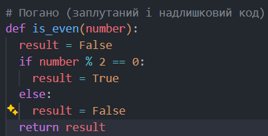

Код містить зайві змінні та непотрібні розгалуження, що ускладнює сприйняття банальної операції.

**Добре (з дотриманням KISS):**
оператор порівняння % 2 == 0 вже сам по собі повертає булеве значення (True або False). Тому функцію можна скоротити до одного прозорого рядка.

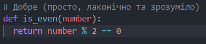

Функція робить тільки те, що від неї вимагається, не має жодного зайвого рядка коду й читається миттєво.

**Комплекс принципів SOLID**

SOLID -  це фундаментальний акронім із п'яти принципів об'єктно-орієнтованого програмування та проєктування. Цей комплекс принципів допомагає створювати зрозумілий, гнучкий, масштабований код, який легко тестувати та підтримувати у довгостроковій перспективі.

1. Принцип єдиної відповідальності (Single Responsibility Principle — SRP)

**Клас чи модуль повинен мати лише одну причину для зміни.**

Це означає, що один клас має відповідати лише за один бізнес-процес або одну частину функціональності. Якщо клас робить занадто багато різних речей (наприклад, працює з базою даних і водночас генерує PDF-звіти), його потрібно розділити.

Приклад коду:

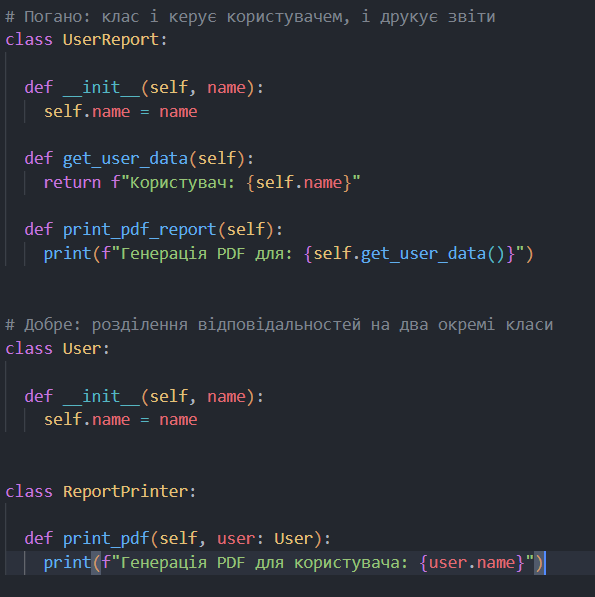

2. Принцип відкритості/закритості (Open/Closed Principle — OCP)

**Програмні сутності мають бути відкритими для розширення, але закритими для модифікації.**

Ви повинні мати можливість додавати нову функціональність до системи без зміни вже існуючого, перевіреного коду. Зазвичай це досягається за допомогою поліморфізму, інтерфейсів або абстрактних класів.

Приклад коду:

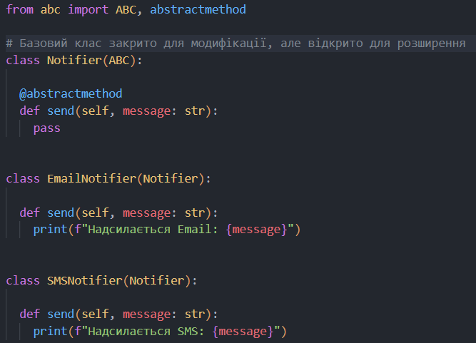

3. Принцип підстановки Лісков (Liskov Substitution Principle — LSP)

**Об'єкти в програмі мають бути замінюваними на екземпляри їхніх підтипів без порушення правильності роботи програми.**

Якщо клас B є підкласом класу A, то будь-який об'єкт типу A можна без проблем замінити на об'єкт типу B, і програма не повинна через це ламатися чи змінювати свою логіку непередбачуваним чином.

Приклад коду:

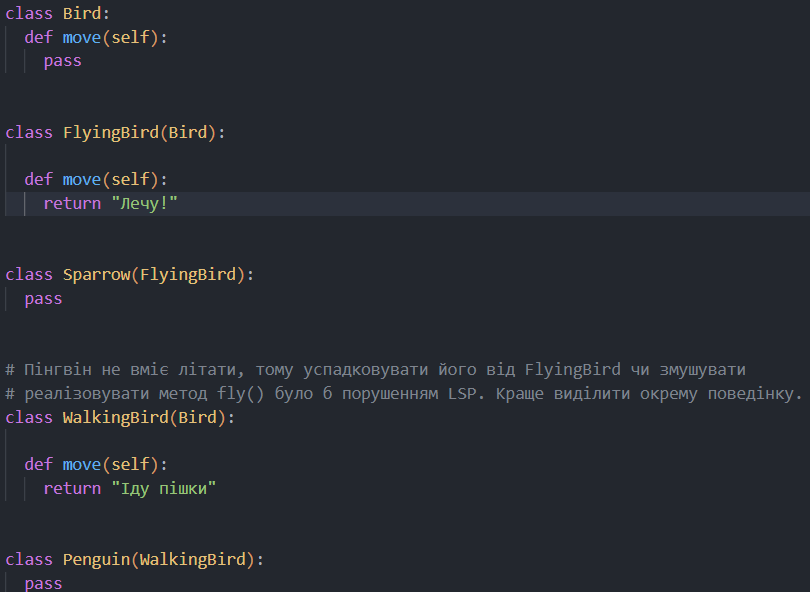

4. Принцип розділення інтерфейсу (Interface Segregation Principle — ISP)

**Клієнти не повинні примусово залежити від методів, які вони не використовують.**

Краще створити багато маленьких, спеціалізованих інтерфейсів (або базових класів), ніж один великий «універсальний» інтерфейс, методи якого підкласам доводиться залишати порожніми або викидати помилки.

Приклад коду:

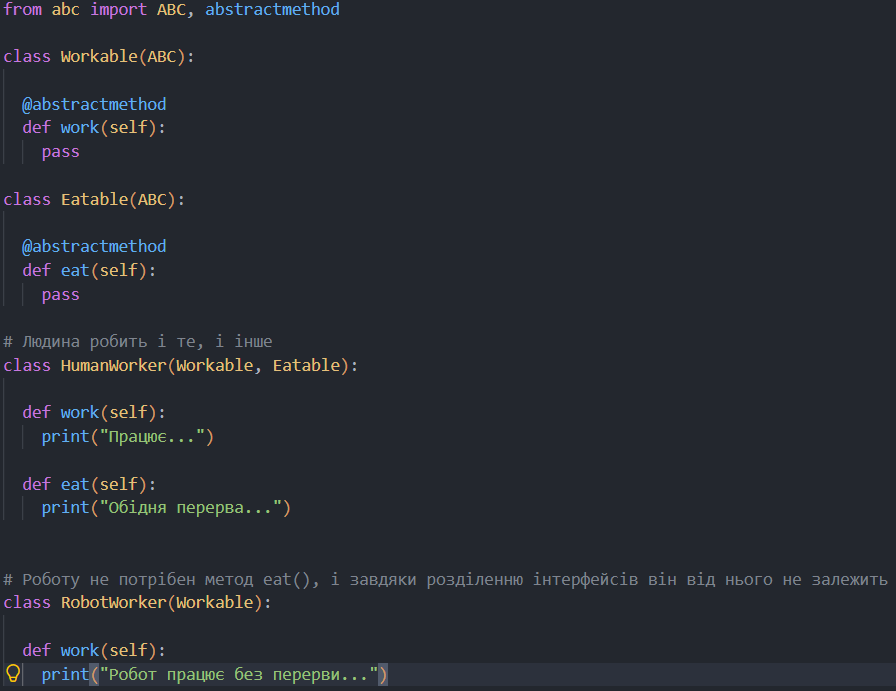

5. Принцип інверсії залежностей (Dependency Inversion Principle — DIP)

**Модулі верхніх рівнів не повинні залежити від модулів нижніх рівнів. Обидва типи модулів мають залежити від абстракцій.**

Цей принцип дозволяє зменшити зв'язність у проєкті. Замість того щоб високорівнева бізнес-логіка напряму залежала від конкретних баз даних чи сервісів (MySQL, Stripe API тощо), вони обидва мають посилатися на спільні інтерфейси (абстракції).

Приклад коду:

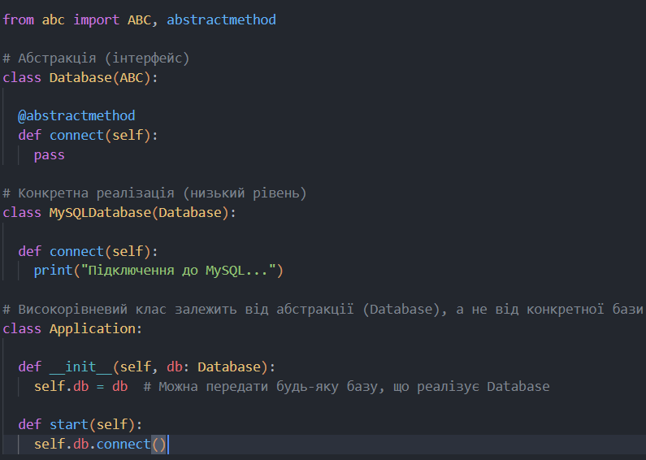

Висновки:
під час виконання практичної роботи було детально досліджено теоретичні та практичні аспекти застосування основних принципів проєктування програмного забезпечення, зокрема базових підходів (DRY, AHA, KISS) та фундаментального комплексу принципів SOLID.

В ході роботи було досягнуто таких результатів:

Опановано базові принципи:
1. DRY дозволив уникнути дублювання логіки та централізувати обчислення.   
2. AHA продемонстрував важливість уникнення передчасних і складних абстракцій, коли дублювання є тимчасово прийнятним.
3. KISS показав переваги простих і зрозумілих рішень над надмірно ускладненими.

Проаналізовано та реалізовано на практиці комплекс принципів SOLID:   
1. SRP: розділено відповідальності між класами для збереження єдиної причини для змін.   
2. OCP: реалізовано можливість розширення функціональності через абстракції без модифікації наявного коду.   
3. LSP: забезпечено правильну підстановку підкласів замість базових класів без порушення цілісності системи.   
4. ISP: створено вузькоспеціалізовані інтерфейси замість громіздких універсальних.   
5. DIP: зменшено рівень зв'язності (coupling) шляхом залучення абстракцій для взаємодії між модулями.