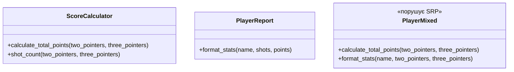

**Львівський національний університет ветеринарної медицини та біотехнологій імені С.З. Ґжицького**

**Кафедра інформаційних технологій** 

# Звіт 
про виконання лабораторної роботи №11
на тему: 

**"Принципи проєктування програмного забезпечення"**

Виконав студент групи КН-31 Ваврущак Назар

Прийняв доц. Андрій Татомир

**Львів 2026**

---

## Мета роботи 
Познайомитися з найбільш поширеними сучасними принципами проєктування програмного забезпечення.

## Хід роботи

1. Опрацьовано принципи проєктування. Це правила, за якими код легше читати і змінювати: одна правка не тягне за собою сусідні, не пов'язані з нею частини. Найвідоміший набір — SOLID: єдина відповідальність, відкритість/закритість, підстановка Лісков, розділення інтерфейсу, інверсія залежностей.
2. Принцип єдиної відповідальності означає, що клас має одну причину для зміни. Якщо в ньому зібрані дві різні справи, зміна однієї чіпає й другу.
 У прикладі ці дві справи — правило нарахування очок і текст статистики гравця. Очки залежать від вартості двоочкового і триочкового кидка. Рядок статистики залежить від того, як показати ім'я, кількість кидків і суму. Це різні причини для правки.
 Правильний варіант розкладено на два файли. [scoring.py](scoring.py) лише рахує очки і кількість кидків. [player_report.py](player_report.py) лише складає рядок з уже готових імені, кидків і очок і не містить формули нарахування.
 Неправильний варіант — [player_mixed.py](player_mixed.py). Клас PlayerMixed і рахує очки, і форматує рядок. Цей файл порушує принцип єдиної відповідальності: зміна правила очок і зміна формату звіту вимагають правки того самого класу.
 Демонстрація та сама, що в лабораторній №7: Nazar, 15 двоочкових і 2 триочкових, рядок Player: Nazar | Shots: 17 | Score: 36. На Рис. 1 зображено два окремі класи і клас PlayerMixed, який змішує обидві відповідальності.

Рис. 1 - UML-діаграма розділення нарахування очок і тексту статистики

## Висновок
У підсумку виконання лабораторної роботи ознайомився з п'ятьма принципами SOLID, а саме: принцип єдиної відповідальності, відкритості/закритості, підстановки Лісков, розділення інтерфейсу, інверсії залежностей. На практиці розібрано єдину відповідальність: розрахунок очок і текст звіту гравця винесено в окремі файли, а змішаний клас залишено як приклад порушення принципу.
