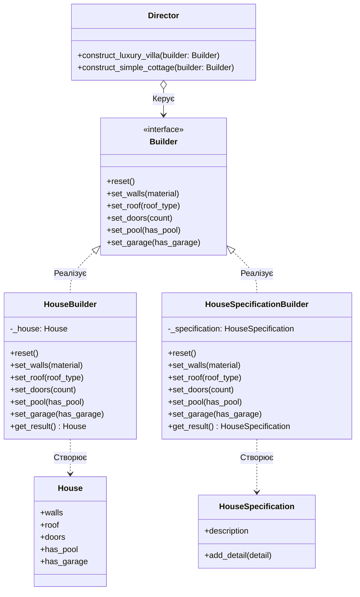

**Львівський національний університет ветеринарної медицини та біотехнологій імені С.З. Ґжицького**

**Кафедра інформаційних технологій** 

# Звіт 
про виконання лабораторної роботи №12
на тему: 

**"Твірні шаблони проєктування"**

Виконав студент групи КН-31 Ваврущак Назар

Прийняв доц. Андрій Татомир

**Львів 2026**

---

## Мета роботи 
Познайомитися з групою твірних шаблонів проєктування.

## Хід роботи

1. Опрацьовано твірні шаблони, які відокремлюють процес створення об'єктів від їх подальшого використання. Система отримує готовий результат і не прив'язана до конкретного способу його складання.
2. Будівельник являє собою твірний патерн проєктування, який збирає складний об'єкт крок за кроком і відділяє порядок цих кроків від конкретного представлення результату.
 У моїй роботі цей патерн розв'язує проблему збирання будинку і технічної документації за одним сценарієм. Вілла і котедж задаються однаковими кроками, але на виході можна отримати або об'єкт будинку, або текст специфікації.
 Якщо не використовувати будівельник, довелося б передавати в конструктор одразу стіни, дах, двері, басейн і гараж, а для документації повторювати ті самі кроки окремим кодом. Використання будівельника обумовлене тим, що порядок кроків зібрано в одному місці, а спосіб запису результату лишається в окремому будівельнику.
 Приклад реалізованого шаблону будівельник на основі будинку та документації [lab12](lab12.py). На Рис. 1 зображено інтерфейс Builder, який реалізують HouseBuilder і HouseSpecificationBuilder, а Director керує кроками збирання.

Рис. 1 - UML-діаграма класів з реалізацією патерну "Будівельник" для будинку та документації

## Висновок
У підсумку виконання лабораторної роботи ознайомився з п'ятьма твірними шаблонами, а саме: фабричний метод, абстрактна фабрика, будівельник, прототип, одинак. На практиці навчився працювати з будівельником, що дало змогу збирати різні представлення будинку одними й тими самими кроками.
