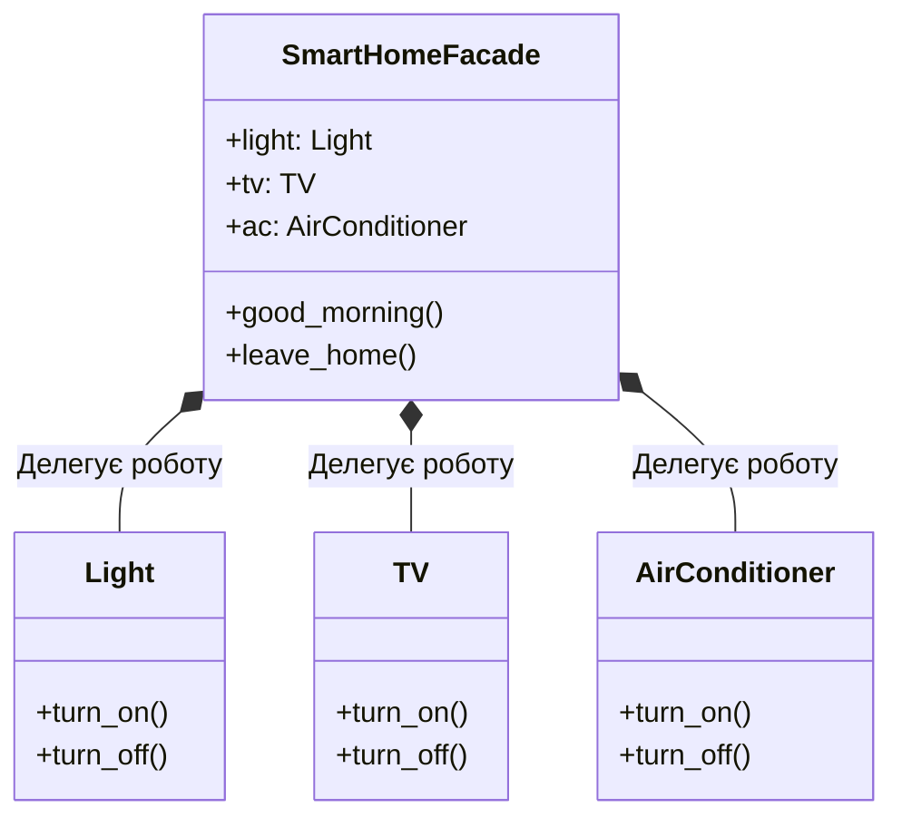

**Львівський національний університет ветеринарної медицини та біотехнологій імені С.З. Ґжицького**

**Кафедра інформаційних технологій** 

# Звіт 
про виконання лабораторної роботи №13
на тему: 

**"Структурні шаблони проєктування"**

Виконав студент групи КН-31 Ваврущак Назар

Прийняв доц. Андрій Татомир

**Львів 2026**

---

## Мета роботи 
Познайомитися з групою структурних шаблонів проєктування.

## Хід роботи

1. Опрацьовано структурні шаблони, які описують, як складати класи та об'єкти у більші структури і при цьому не ламати вже наявні зв'язки, коли з'являється новий компонент.
2. Фасад являє собою структурний патерн проєктування, який ховає набір класів за одним простим інтерфейсом. Клієнт викликає один метод сценарію і не працює з кожною частиною підсистеми окремо.
 У моїй роботі цей патерн розв'язує проблему керування розумним домом. Світло, телевізор і кондиціонер мають власні методи вмикання та вимикання, а для ранкового сценарію і виходу з дому потрібна одна команда.
 Якщо не використовувати фасад, клієнтський код мусив би сам створювати Light, TV і AirConditioner і викликати їх по черзі в кожному сценарії. Додавання нового кроку означало б правку кожного такого місця. Використання фасаду обумовлене тим, що порядок дій зібрано в SmartHomeFacade, а клієнт викликає лише good_morning або leave_home.
 Приклад реалізованого шаблону фасад на основі системи розумного дому [lab13](lab13.py). На Рис. 1 зображено клас SmartHomeFacade, який у конструкторі створює Light, TV і AirConditioner та делегує їм роботу в методах good_morning і leave_home.

Рис. 1 - UML-діаграма класів з реалізацією патерну "Фасад" для розумного дому

## Висновок
У підсумку виконання лабораторної роботи ознайомився з сімома структурними шаблонами, а саме: адаптер, міст, компонувальник, декоратор, фасад, легковаговик, замісник. На практиці навчився працювати з фасадом, що дало змогу сховати вмикання світла, телевізора і кондиціонера за двома сценаріями.
