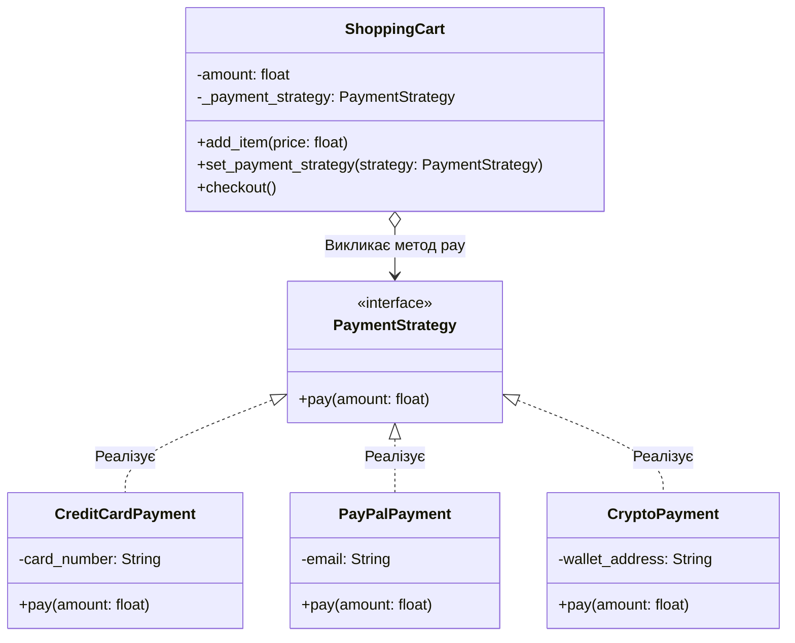

**Львівський національний університет ветеринарної медицини та біотехнологій імені С.З. Ґжицького**

**Кафедра інформаційних технологій** 

# Звіт 
про виконання лабораторної роботи №14
на тему: 

**"Поведінкові шаблони проєктування"**

Виконав студент групи КН-31 Ваврущак Назар

Прийняв доц. Андрій Татомир

**Львів 2026**

---

## Мета роботи 
Познайомитися з групою поведінкових шаблонів проєктування.

## Хід роботи

1. Опрацьовано поведінкові шаблони, які задають спосіб взаємодії об'єктів і розподіляють обов'язки так, щоб класи менше залежали один від одного.
2. Стратегія являє собою поведінковий патерн проєктування, який виносить кожен варіант алгоритму в окремий клас і дає змогу підміняти його під час виконання.
 У моїй роботі цей патерн розв'язує проблему оплати кошика. Картка, PayPal і криптогаманець проводять платіж по-різному, а кошик має лише порахувати суму і передати її обраному способу.
 Якщо не використовувати стратегію, метод checkout містив би ланцюжок умов за типом оплати, і кожен новий спосіб довелося б дописувати в сам кошик. Використання стратегії обумовлене тим, що ShoppingCart викликає лише pay, а конкретна оплата лишається в CreditCardPayment, PayPalPayment або CryptoPayment.
 Приклад реалізованого шаблону стратегія на основі кошика та способів оплати [lab14](lab14.py). На Рис. 1 зображено інтерфейс PaymentStrategy, який реалізують три способи оплати, і клас ShoppingCart, що зберігає обрану стратегію.

Рис. 1 - UML-діаграма класів з реалізацією патерну "Стратегія" для оплати кошика

## Висновок
У підсумку виконання лабораторної роботи ознайомився з десятьма поведінковими шаблонами, а саме: ланцюжок обов'язків, команда, ітератор, посередник, знімок, спостерігач, стан, стратегія, шаблонний метод, відвідувач. На практиці навчився працювати зі стратегією, що дало змогу міняти спосіб оплати без зміни класу кошика.
