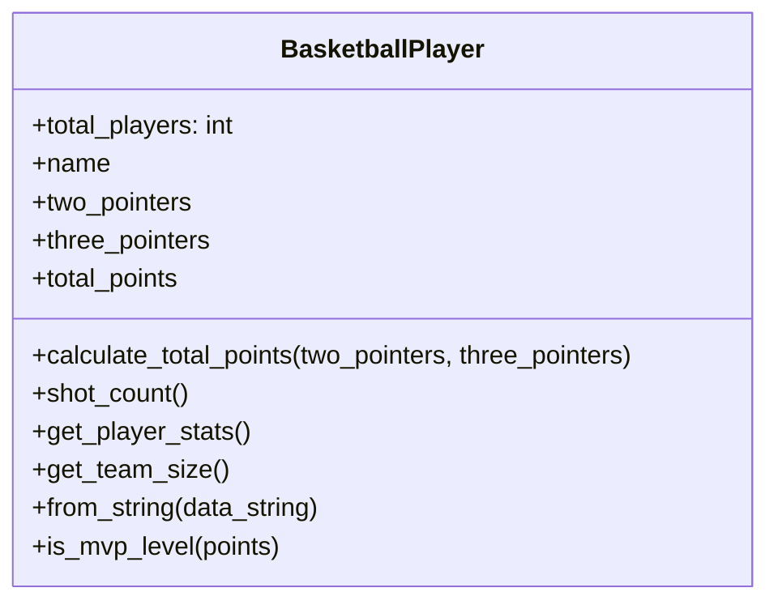

**Львівський національний університет ветеринарної медицини та біотехнологій імені С.З. Ґжицького**

**Кафедра інформаційних технологій**

# Звіт 
про виконання лабораторної роботи №15
на тему: 

**"Рефакторинг програмного забезпечення"**

Виконав студент групи КН-31 Ваврущак Назар

Прийняв доц. Андрій Татомир

**Львів 2026**

---

## Мета роботи 

Познайомитися з основними принципами та найбільш поширеними техніками рефакторингу програмного забезпечення.

## Короткі теоретичні відомості

Рефакторинг — це зміна внутрішньої структури коду без зміни його поведінки. Принцип роботи полягає в дрібних кроках: за один раз змінюється одна річ, нова поведінка при цьому не додається, а після кроку перевіряється, що результат програми залишився тим самим. Серед технік: виділення методу, перейменування, вбудовування методу, заміна тимчасової змінної викликом, виділення класу, заміна умовного оператора поліморфізмом і заміна магічного числа символьною константою.

## Хід роботи

1. За основу взято клас BasketballPlayer з лабораторної №7. У формулі очок і в перевірці рівня MVP стояли літерали, з яких не видно правило нарахування. Для цього застосовано техніку заміни магічного числа символьною константою: значенням дано імена, а розрахунок очок винесено в окремий метод. Демонстрація лишилася тією самою: Nazar (15 і 2), Taras (8 і 12), LeBron з рядка "LeBron-12-4". Повторний запуск дав той самий вивід, тож наявний функціонал збережено. Код після змін: [lab15](lab15.py).
```diff
-        self.total_points = (self.two_pointers * 2) + (self.three_pointers * 3)
+        self.total_points = self.calculate_total_points(two_pointers, three_pointers)

-        if points >= 30:
+        if points >= MVP_POINTS_THRESHOLD:
             return "Yes, MVP level!"
```

2. Запах коду — це ознака, що структуру буде важко змінювати, хоча програма може працювати правильно. Серед таких ознак: довгий метод, дублювання, великий клас, довгий ланцюжок умов і магічні числа. Детально розглянуто магічні числа. У вихідному класі літерали 2, 3 і 30 нічого не пояснюють самі по собі: це очки за двоочковий кидок, за триочковий і поріг MVP. Якщо правило зміниться, легко виправити число лише в одному місці і залишити старе значення в іншому. Іменовані константи TWO_POINT_VALUE, THREE_POINT_VALUE і MVP_POINTS_THRESHOLD збирають кожне правило в одному місці.
<br>На Рис. 1 зображено клас BasketballPlayer після рефакторингу: розрахунок очок зібрано в calculate_total_points, кількість кидків — у shot_count, а get_player_stats лише формує рядок.


Рис. 1 - UML-діаграма класу BasketballPlayer після заміни магічних чисел

## Висновок
У підсумку виконання лабораторної роботи ознайомився з принципами рефакторингу і технікою заміни магічного числа символьною константою. Під час роботи навчився прибирати з класу BasketballPlayer літерали, сенс яких не видно з запису, і перевіряти, що вивід програми після цього не змінився.
