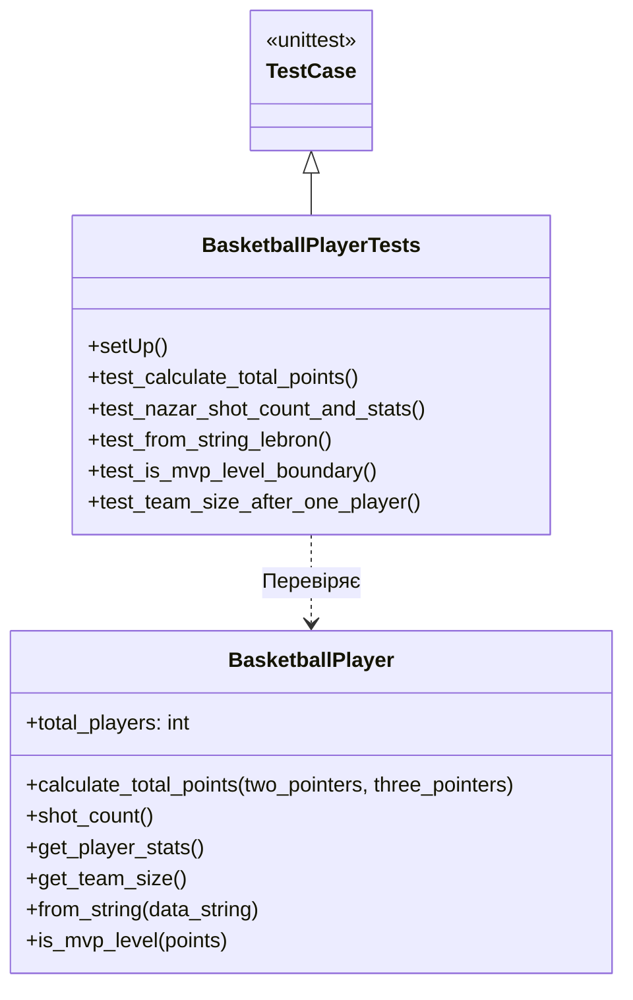

**Львівський національний університет ветеринарної медицини та біотехнологій імені С.З. Ґжицького**

**Кафедра інформаційних технологій**

# Звіт 
про виконання лабораторної роботи №16
на тему: 

**"Тестування програмного коду"**

Виконав студент групи КН-31 Ваврущак Назар

Прийняв доц. Андрій Татомир

**Львів 2026**

---

## Мета роботи 

Ознайомитися із техніками тестування програмного коду.

## Короткі теоретичні відомості

Тестування фіксує очікуваний результат програми і показує регресію після чергової правки. Unit-тест перевіряє одну функцію або один клас: таких тестів багато, вони швидкі, і за падінням видно конкретне місце, але взаємодію модулів вони не покривають. Інтеграційний тест перевіряє кілька частин разом: він ближчий до реальної роботи, проте повільніший, і причину падіння шукати важче. Наскрізний тест проходить сценарій усієї системи: він ловить помилки на стиках, але таких тестів мало, вони повільні і часто ламаються через дрібниці сценарію, а не через саму логіку. Піраміда тестування ставить unit-тести широкою основою, інтеграційні — середнім шаром, а наскрізні — вузькою верхівкою.

## Хід роботи

1. Unit-тест написано вбудованим модулем unittest. Клас BasketballPlayerTests успадковує unittest.TestCase, кожна перевірка — метод з іменем test_, порівняння робить assertEqual. Перед тестом setUp скидає лічильник гравців, щоб тести не залежали від порядку запуску.
 Код під тестом — клас BasketballPlayer з лабораторної №15. Файл тієї лабораторної під час імпорту друкує демонстрацію, тому клас перенесено в [lab16](lab16.py) без цього сценарію, а тести додано в тому самому файлі.
 Перевірено нарахування очок: Nazar (15 і 2) дає 36, Taras (8 і 12) дає 52, LeBron (12 і 4) дає 36. Окремо перевірено кількість кидків і рядок статистики Назара, створення гравця з рядка "LeBron-12-4", межу MVP (30 очок — рівень MVP, 29 — ще ні) і текст звіту команди після одного гравця.
 Запуск з папки лабораторної: `python3 -m unittest lab16.py`. Прогін завершився з OK, пройшло 5 тестів.
 На Рис. 1 зображено клас BasketballPlayerTests, який успадковує unittest.TestCase і перевіряє BasketballPlayer. Кожен метод test_ відповідає одній перевірці з файлу.

Рис. 1 - UML-діаграма класів unit-тестів для BasketballPlayer

## Висновок
У підсумку виконання лабораторної роботи ознайомився з видами тестів і пірамідою тестування. На практиці навчився писати unit-тести модулем unittest для класу BasketballPlayer і запускати їх командою python3 -m unittest.
