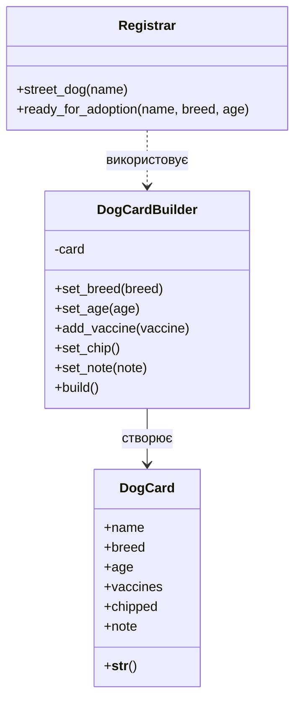

## Львівський національний університет ветеринарної медицини та біотехнологій імені С.З. Ґжицького

### Кафедра інформаційних технологій 

# Звіт про виконання лабораторної роботи №12
На тему: "Твірні шаблони проєктування"

Виконав студент групи КН-31 Павлишин Павло

Прийняв доц. Андрій Татомир

### Львів 2026

---

**Мета роботи** - познайомитися з групою твірних шаблонів проєктування.

## Хід роботи 

1. Опрацьовано групу твірних шаблонів. Вони описують, яким чином у програмі створюються об'єкти, щоб основний код не залежав від деталей цього створення.
2. Розглянуто п'ять шаблонів цієї групи:
    - **Singleton** - гарантує, що в програмі існує лише один екземпляр класу;
    - **Factory Method** - створення об'єкта доручається підкласам;
    - **Abstract Factory** - створює цілі набори пов'язаних між собою об'єктів;
    - **Builder** - складний об'єкт збирається поступово, по кроках;
    - **Prototype** - новий об'єкт отримують копіюванням уже існуючого.
3. Для практичної частини [lab12](lab12.py) вибрано шаблон **Builder (Будівельник)**. Він зручний тоді, коли об'єкт має багато необов'язкових полів і конструктор з усіма параметрами виходить занадто довгим.
4. Створено клас **DogCard** - анкета собаки в притулку з полями: кличка, порода, вік, щеплення, чіп і примітка. Метод **__str__** виводить анкету в зручному вигляді.
5. Створено клас **DogCardBuilder**, у якого на кожне поле є окремий метод (**set_breed**, **set_age**, **add_vaccine**, **set_chip**, **set_note**). Кожен метод повертає **self**, тому виклики можна записувати ланцюжком. Готову анкету повертає метод **build**.
6. Додано клас **Registrar**, який виконує роль директора. У ньому описано два типові сценарії: анкета для собаки з вулиці та анкета для собаки, що готова до прилаштування.
7. Побудовано UML-діаграму класів:

## Висновок
У підсумку виконання лабораторної роботи ознайомився з твірними шаблонами проєктування та реалізував шаблон **Builder** на прикладі анкети собаки в притулку.

Будівельник дозволив уникнути конструктора з великою кількістю параметрів: заповнюються лише ті поля, які потрібні в конкретному випадку. Клас-директор зберігає готові варіанти збирання, тому однаковий код створення анкет не повторюється в різних місцях програми.
