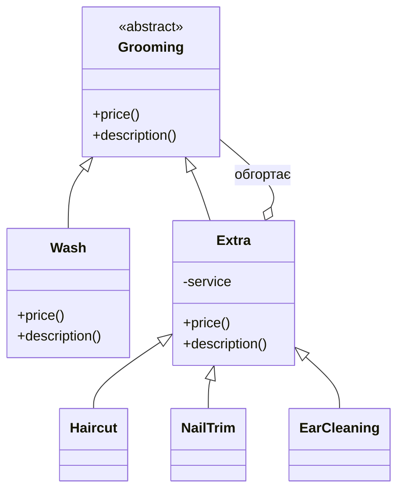

## Львівський національний університет ветеринарної медицини та біотехнологій імені С.З. Ґжицького

### Кафедра інформаційних технологій 

# Звіт про виконання лабораторної роботи №13
На тему: "Структурні шаблони проєктування"

Виконав студент групи КН-31 Павлишин Павло

Прийняв доц. Андрій Татомир

### Львів 2026

---

**Мета роботи** - познайомитися з групою структурних шаблонів проєктування.

## Хід роботи 

1. Опрацьовано групу структурних шаблонів. Вони показують, як з окремих класів та об'єктів складати більші конструкції, щоб вони залишались гнучкими.
2. Розглянуто сім шаблонів цієї групи:
    - **Adapter** - дає змогу працювати разом класам з несумісними інтерфейсами;
    - **Bridge** - розділяє абстракцію та її реалізацію;
    - **Composite** - об'єднує об'єкти в деревоподібну структуру;
    - **Decorator** - додає об'єкту нову поведінку, обгортаючи його;
    - **Facade** - дає простий інтерфейс до складної підсистеми;
    - **Flyweight** - економить пам'ять за рахунок спільних даних;
    - **Proxy** - підставляє замість об'єкта його замісника.
3. Для практичної частини [lab13](lab13.py) вибрано шаблон **Decorator (Декоратор)**. Його реалізовано на прикладі послуг грумінг-салону для собак.

    У моїй роботі цей шаблон вирішує проблему великої кількості комбінацій послуг: до миття клієнт може замовити стрижку, підрізання кігтів, чистку вух або будь-який їх набір.

    Без декоратора довелося б створювати окремий клас-нащадок на кожну комбінацію (**WashWithHaircut**, **WashWithHaircutAndNails** і т.д.) - для трьох додаткових послуг це вже вісім класів, а кожна нова послуга подвоює їх кількість. Інший варіант - один клас з прапорцями та набором **if** у методі **price**, але тоді його довелося б змінювати щоразу, коли в салоні з'являється нова послуга.
4. Створено абстрактний клас **Grooming** з методами **price** і **description**. Базова послуга - клас **Wash** (миття).
5. Створено клас **Extra** - базовий декоратор. Він зберігає в собі іншу послугу і за замовчуванням просто передає їй виклики.
6. Від **Extra** успадковано додаткові послуги: **Haircut**, **NailTrim** і **EarCleaning**. Кожна з них додає свою вартість до ціни та свій текст до опису вкладеної послуги.
7. Оскільки декоратори мають той самий інтерфейс, що й базова послуга, їх можна вкладати один в одного в будь-якій кількості та порядку, наприклад **EarCleaning(NailTrim(Haircut(Wash())))**.
8. Побудовано UML-діаграму класів:

## Висновок
У підсумку виконання лабораторної роботи ознайомився зі структурними шаблонами проєктування та реалізував шаблон **Decorator** на прикладі послуг грумінгу.

Без декоратора для кожної комбінації послуг довелось би створювати окремий клас (миття зі стрижкою, миття зі стрижкою і кігтями і т.д.). З декоратором достатньо одного класу на кожну додаткову послугу, а потрібний набір складається вже під час роботи програми.
