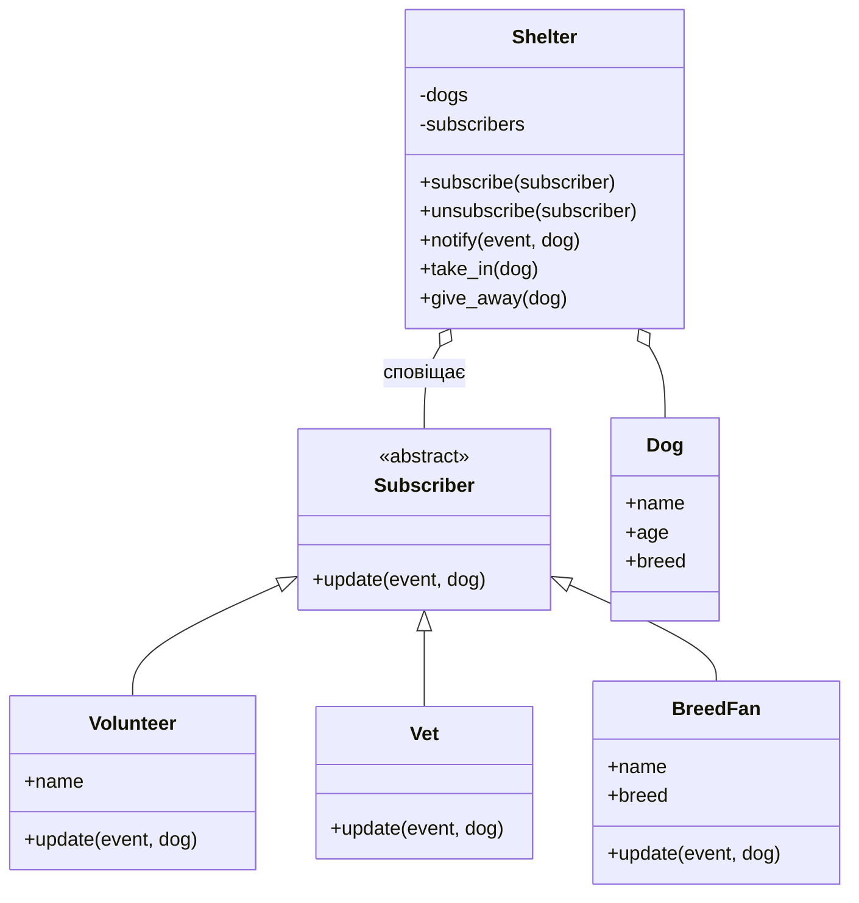

## Львівський національний університет ветеринарної медицини та біотехнологій імені С.З. Ґжицького

### Кафедра інформаційних технологій 

# Звіт про виконання лабораторної роботи №14
На тему: "Поведінкові шаблони проєктування"

Виконав студент групи КН-31 Павлишин Павло

Прийняв доц. Андрій Татомир

### Львів 2026

---

**Мета роботи** - познайомитися з групою поведінкових шаблонів проєктування.

## Хід роботи 

1. Опрацьовано групу поведінкових шаблонів. Вони описують, як об'єкти спілкуються між собою і як між ними ділляться обов'язки.
2. Розглянуто шаблони цієї групи:

    | Шаблон | Призначення |
    |--------|-------------|
    | **Chain of Responsibility** | запит передається ланцюжком обробників |
    | **Command** | дія оформлюється як окремий об'єкт |
    | **Iterator** | послідовний обхід елементів колекції |
    | **Mediator** | об'єкти спілкуються через посередника |
    | **Memento** | збереження та відновлення стану об'єкта |
    | **Observer** | сповіщення підписників про подію |
    | **State** | поведінка об'єкта залежить від його стану |
    | **Strategy** | взаємозамінні алгоритми в окремих класах |
    | **Template Method** | каркас алгоритму з кроками, які змінюють підкласи |
    | **Visitor** | нова операція без зміни класів, над якими вона виконується |

3. Для практичної частини [lab14](lab14.py) вибрано шаблон **Observer (Спостерігач)**. Його реалізовано на прикладі притулку для собак, за основу взято клас **Dog** з попередніх лабораторних.

    У моїй роботі цей шаблон вирішує проблему сповіщення різних людей про події в притулку: коли прибуває чи знаходить дім собака, про це мають дізнатись волонтери, ветеринар і ті, хто чекає на певну породу.

    Без спостерігача клас **Shelter** мав би сам зберігати посилання на кожного волонтера, ветеринара та охочого і в методах **take_in** та **give_away** викликати в кожного свій окремий метод. Притулок залежав би від усіх цих класів, і для кожного нового типу отримувача довелося б змінювати його код. Крім того, не було б простого способу перестати сповіщати когось під час роботи програми.
4. Створено абстрактний клас **Subscriber** з методом **update**, який отримує назву події та собаку, з якою ця подія відбулась.
5. Створено трьох підписників, які по-різному реагують на події:
    - **Volunteer** - реагує і на прибуття собаки, і на її прилаштування;
    - **Vet** - реагує тільки на прибуття нової собаки;
    - **BreedFan** - реагує тільки тоді, коли прибула собака потрібної породи.
6. Створено клас **Shelter**, який є видавцем. Методи **subscribe** та **unsubscribe** керують списком підписників, а **notify** викликає **update** у кожного з них. Сповіщення надсилаються з методів **take_in** (собака прибула) та **give_away** (собаку забрали).
7. У прикладі показано, що після виклику **unsubscribe** підписник перестає отримувати сповіщення.
8. Побудовано UML-діаграму класів:

## Висновок
У підсумку виконання лабораторної роботи ознайомився з поведінковими шаблонами проєктування та реалізував шаблон **Observer** на прикладі притулку для собак.

Притулок нічого не знає про конкретних підписників, він лише викликає в них метод **update**. Тому нового учасника (наприклад, розсилку в соцмережі) можна додати окремим класом, не змінюючи код притулку, а підписуватись і відписуватись можна прямо під час роботи програми.
