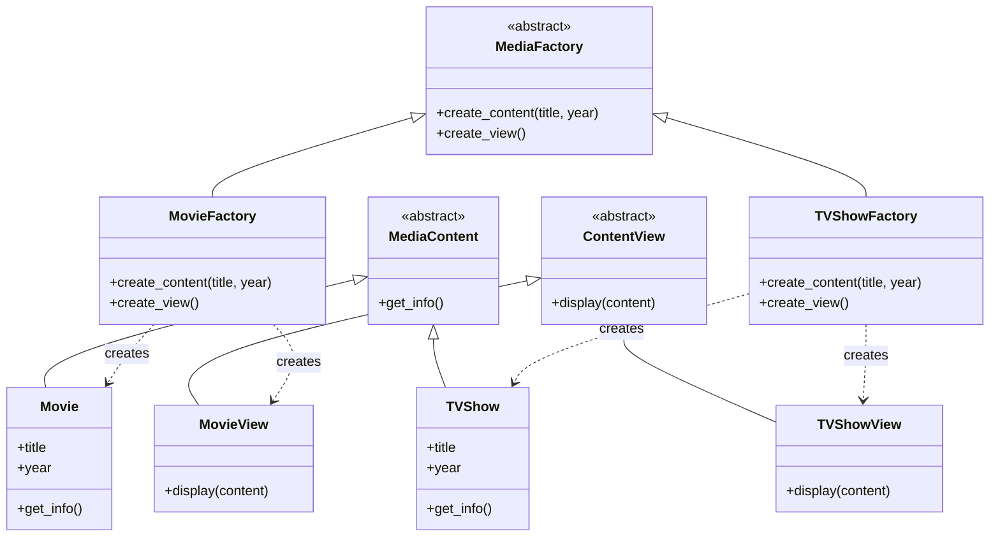

# Львівський національний університет ветеринарної медицини та біотехнологій імені С. З. Ґжицького

### Кафедра інформаційних технологій

# Звіт

про виконання лабораторної роботи №12 на тему:

**«Твірні шаблони проєктування»**

Виконав студент групи КН-31 Олександр Верик

Прийняв доц. Андрій Татомир

### Львів 2026

---

**Мета роботи** — познайомитися з групою твірних шаблонів проєктування.

## Хід роботи

1. У ході роботи ознайомився з твірними шаблонами проєктування, які використовуються для створення об'єктів та дозволяють відокремити цей процес від основної логіки програми.

2. До основних твірних шаблонів належать:
   - Singleton (Одинак);
   - Factory Method (Фабричний метод);
   - Abstract Factory (Абстрактна фабрика);
   - Builder (Будівельник);
   - Prototype (Прототип).

3. Для виконання практичної частини обрано шаблон **Abstract Factory (Абстрактна фабрика)**. Він дозволяє створювати групи пов'язаних об'єктів, не залежачи від їхніх конкретних класів.

   Реалізацію виконано на прикладі каталогу медіаконтенту. Створено фабрики для фільмів і серіалів, кожна з яких відповідає за створення об'єкта контенту та його представлення. Детальніше реалізацію описано у файлі [lab12.py](lab12.py).

4. Для наочного відображення структури шаблону та зв'язків між класами побудовано UML-діаграму.

_Рис. 1 — UML-діаграма класів із реалізацією шаблону «Абстрактна фабрика»._

## Висновок

У результаті виконання лабораторної роботи ознайомився з твірною групою шаблонів проєктування, їхнім призначенням та основними представниками. Детальніше розглянув принцип роботи шаблону Abstract Factory, його особливості та сферу застосування. На прикладі каталогу фільмів і серіалів реалізував даний шаблон мовою Python та побудував UML-діаграму, яка відображає структуру класів і зв'язки між ними. Закріпив розуміння використання абстрактної фабрики для створення сімейств пов'язаних об'єктів.
