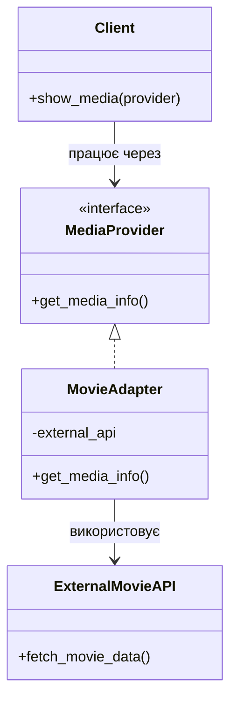

# Львівський національний університет ветеринарної медицини та біотехнологій імені С. З. Ґжицького

### Кафедра інформаційних технологій

# Звіт

про виконання лабораторної роботи №13 на тему:

**«Структурні шаблони проєктування»**

Виконав студент групи КН-31 Олександр Верик

Прийняв доц. Андрій Татомир

### Львів 2026

---

**Мета роботи** — познайомитися з групою структурних шаблонів проєктування.

## Хід роботи

1. У ході роботи ознайомився зі структурними шаблонами проєктування, які використовуються для організації взаємодії між класами та об'єктами. Вони допомагають спростити структуру програми, об'єднувати окремі компоненти та забезпечувати їхню сумісність.

2. До основних структурних шаблонів належать:
   - Adapter (Адаптер);
   - Bridge (Міст);
   - Composite (Компонувальник);
   - Decorator (Декоратор);
   - Facade (Фасад);
   - Flyweight (Пристосуванець);
   - Proxy (Замісник).

3. Для практичної частини обрано шаблон **Adapter (Адаптер)**. Його призначення — забезпечення сумісності між класами з різними інтерфейсами без необхідності змінювати їхню внутрішню реалізацію.

   Практичну реалізацію виконано на прикладі каталогу медіаконтенту. Створено зовнішнє джерело даних, яке повертає інформацію про фільми у власному форматі, та адаптер, який перетворює ці дані у формат, зрозумілий каталогу.

   Виконання лабораторної роботи наведено у файлі [lab13.py](lab13.py).

4. Для відображення структури шаблону та взаємозв'язків між його компонентами побудовано UML-діаграму.

_Рис. 1 — UML-діаграма класів із реалізацією шаблону «Адаптер» для підключення зовнішнього джерела даних._

## Висновок

У результаті виконання лабораторної роботи ознайомився зі структурною групою шаблонів проєктування та їхнім призначенням. Детальніше розглянув шаблон Adapter, його принцип роботи та особливості використання. На прикладі каталогу медіаконтенту реалізував адаптацію зовнішнього джерела даних до інтерфейсу програми мовою Python та побудував UML-діаграму. Закріпив розуміння того, як адаптер допомагає забезпечити сумісність між компонентами з різними інтерфейсами.
