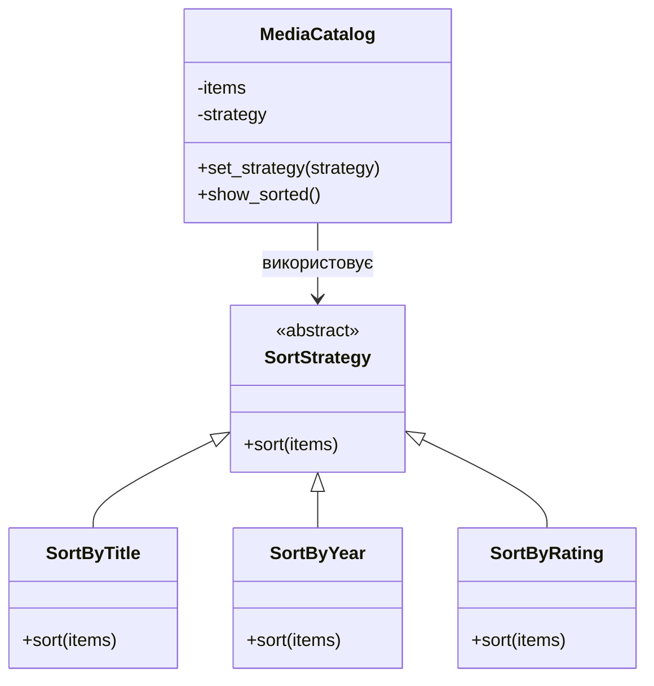

# Львівський національний університет ветеринарної медицини та біотехнологій імені С. З. Ґжицького

### Кафедра інформаційних технологій

# Звіт

про виконання лабораторної роботи №14

на тему: **«Поведінкові шаблони проєктування»**

Виконав студент групи КН-31 Олександр Верик

Прийняв доц. Андрій Татомир

### Львів 2026

---

**Мета роботи** — познайомитися з групою поведінкових шаблонів проєктування.

## Хід роботи

1. Ознайомився з поведінковою групою шаблонів проєктування. Вони визначають способи взаємодії між об'єктами та розподіляють між ними відповідальність.

2. Розглянув основні поведінкові шаблони: Chain of Responsibility, Command, Iterator, Mediator, Memento, Observer, State, Strategy, Template Method, Visitor та Interpreter.

3. Для практичної реалізації обрав шаблон **Strategy (Стратегія)**.

Стратегія (Strategy) являє собою поведінковий шаблон проєктування, який дозволяє визначити декілька варіантів виконання певного завдання, оформити кожен із них в окремий клас та змінювати їх незалежно від основного коду програми.

У моїй роботі цей патерн використовується для реалізації різних способів сортування медіаконтенту. Користувач може обрати сортування фільмів і серіалів за назвою, роком випуску або рейтингом.

Без використання шаблону Strategy цю задачу можна було б реалізувати за допомогою умовних операторів безпосередньо в класі каталогу. Проте при додаванні нових способів сортування довелося б постійно змінювати його код. Використання стратегії дозволяє винести кожен алгоритм в окремий клас та змінювати спосіб сортування без зміни основної логіки програми.

У реалізації клас `MediaCatalog` використовує загальний інтерфейс `SortStrategy`, який реалізують три конкретні стратегії: `SortByTitle`, `SortByYear` та `SortByRating`.

Приклад програмної реалізації наведено у файлі [lab14.py](lab14.py).

4. Побудував UML-діаграму, яка відображає структуру класів та зв'язки між ними.

## UML-діаграма

## Висновок

У результаті виконання лабораторної роботи ознайомився з поведінковою групою шаблонів проєктування, їхнім призначенням та основними представниками. Детальніше розглянув принцип роботи шаблону Strategy, його особливості та сферу застосування. На прикладі каталогу фільмів і серіалів реалізував даний шаблон мовою Python та побудував UML-діаграму, яка відображає структуру класів і зв'язки між ними. Закріпив розуміння використання стратегії для створення взаємозамінних алгоритмів.
